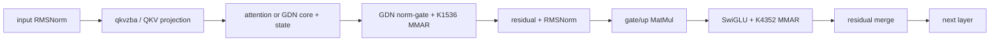
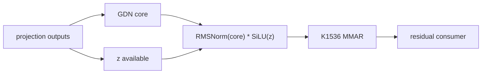

# Qwen3.5-27B TP4/910B4 multi-stream analysis

## 1. Scope and execution boundary

- Model: Qwen3.5-27B BF16, 64 dense hybrid decoder layers, TP4/DP1.
- Runtime: unchanged official vLLM-Ascend 0.23.0; physical NPU0-3 only.
- Objects: GDN terminal, dense MLP tail, and prefill K1536 row-parallel arrival.
- Evidence: `round0/perf-breakdown.md`, the verified round0 timeline, official
  MMAR component artifact, and current t12 runtime-plugin source contract.
- Delivery constraint: any future implementation must be an opt-in,
  independent runtime plugin loaded by read-only mount/PYTHONPATH. This file
  does not authorize implementation.
- Execution-mode boundary: the retained decode route records
  `enable_npugraph_ex=true` with `FULL_DECODE_ONLY`, so decode candidates
  must use the npugraph_ex/aclgraph stream/tagged-event family. The prefill
  compiler/eager route has not been proven by the bounded profile; no prefill
  implementation may choose an API until that route is identified. Ascend-IR
  and npugraph_ex APIs must never be mixed.

This is a direction-level candidate record, not a Plan or dashboard entry. No
NPU/container was used and no product code was changed.

## 2. Evidence constraints

The steady rank-0 decode window is 29.54 ms/token. The MMAR AICPU envelope is
about 28.0 ms/token and overlaps the MMAR AI Core and other MatMul intervals;
these categories are not additive. A stream split cannot claim the entire
AICPU envelope as removable time.

For decode M1, K1536/K4352 MMAR AI Core is contained in its AICPU interval and
cross-rank start spread is already small. The official isolated fused MMAR is
also much faster than a serial matmul plus all-reduce. The opportunity, if any,
is queue/lifecycle overlap with genuinely independent work, not MMAR
decomposition.

For prefill K1536, ranks 0/2/3 spend about 7-8 ms while rank 1 spends
0.15-0.55 ms and all ranks finish nearly together. This is consistent with
waiting/arrival asymmetry. Multi-stream is relevant only if matched
per-rank timestamps show that an independent producer or queue head-of-line
interval exists before the collective. If the long interval is entirely
inside communicator wait, local stream rearrangement has no safe benefit.

## 3. Decoder-layer module DAG

### 3.1 Module list

| id | module | input | output/state | resource/evidence |
|---|---|---|---|---|
| norm_in | input RMSNorm | layer hidden/residual | attention input | vector/memory; serial layer boundary |
| proj | GDN qkvzba or full-attention projection | normalized hidden | q/k/v/z/b/a | MatMul; t12 fuses GDN qkvz+ba |
| core | GDN recurrent core or full attention | projected tensors, cache/state | local attention output, updated state | stateful; GDN-labelled decode only ~0.88 ms/token |
| gdn_term | GDN RMSNorm-gate + K1536 row MMAR | core output, z | TP-reduced attention output | norm/gate then collective, strict data edge |
| residual_norm | residual add + post-attention RMSNorm | attention output, residual | MLP input | consumes reduced output |
| gate_up | dense gate/up projection | MLP input | split gate/up activations | MatMul |
| mlp_tail | SwiGLU + K4352 row MMAR | gate/up output | TP-reduced MLP output | vector op then collective, strict data edge |
| layer_merge | residual merge | MLP output, residual | next-layer hidden | next layer cannot start early |

### 3.2 Dependencies

Every edge in the main layer chain is a data or state dependency:

`norm_in -> proj -> core -> gdn_term -> residual_norm -> gate_up ->
mlp_tail -> layer_merge -> next layer`.

GDN state/KV state adds a state edge across tokens. K1536 and K4352
collectives add a fixed `collective_order` edge across ranks. Consequently,
whole attention and whole MLP modules cannot be placed on parallel streams.
Only precomputation/prefetch with already-available inputs, or row-wise
prefill pipelining with identical rank ordering, remains eligible.

## 4. Parallel point G — GDN terminal vicinity

### 4.1 Operator DAG and hard serial section

After projection, `z` and the q/k/v/b/a inputs are simultaneously
available. The GDN core does not consume `z`; the terminal gate does.
Therefore a side computation derived only from `z`, or an output-weight
prefetch, may overlap the core. Within the terminal itself,
`core_out -> RMSNorm/gate -> K1536 MMAR -> residual` is strictly serial.
The K1536 MMAR result is required before residual/post-attention norm and the
MLP; overlapping it with next-layer compute would change semantics.

### 4.2 Arrangement G1 — precompute the z gate beside GDN core

- Main stream: GDN core and state update.
- Side stream: `SiLU(z)` (including any required cast) immediately after
  projection.
- Join: a tagged event immediately before a terminal operator that consumes
  `core_out` and the precomputed gate.
- Intended overlap: vector/memory gate preparation under the stateful core.
- GE/graph risk: `Cast/SiLU/Reshape` are exactly the cheap consumers that may
  be pulled to the main stream and create a false barrier. On npugraph_ex,
  use one string-tag side scope and explicit event; short-lived gate storage
  needs lifecycle/record-stream treatment. On a proven Ascend-IR prefill path,
  the complete cast+SiLU must be pinned inside the side scope.
- Precision: mathematical order must remain
  `RMSNorm(core_out) * SiLU(z)`; do not move multiplication before norm.
- Promotion prerequisite: first prove the existing fused `self.norm(x,z)`
  can accept/precompute the gate without losing more time than is overlapped.
  Require physical `overlap_pct >=0.5` and lower GDN-terminal wall. If the
  split loses the existing fused norm-gate benefit, reject.

### 4.3 Arrangement G2 — output-weight prefetch beside GDN core

- Main stream: GDN core.
- Side stream: a bounded prefetch/preprocess of this layer's K1536
  `out_proj.weight`, whose contents are immutable and independent of core
  output.
- Join: wait only before `AscendRowParallelLinear.forward`.
- Intended overlap: hide weight/cache preparation without materializing a
  cross-stream activation.
- Risk: prefetch is a cache hint, not guaranteed useful work; it may evict core
  state or simply serialize in the runtime. The current gate/up prefetch
  experience shows that activation markers do not prove E2E benefit.
- Gate: profile the prefetch op/window and core dominator. Require
  `overlap_pct >=0.5`, no core-duration regression, and lower terminal wall
  in at least five warm profiles after dropping cold runs.

G1 and G2 are alternative first experiments. Combining them before either
passes is prohibited. There is no third safe GDN-terminal split: norm and
MMAR have a direct data dependency, and MMAR and residual/next-layer work also
have a direct dependency.

## 5. Parallel point D — dense MLP tail

### 5.1 Decode conclusion: no safe compute-overlap candidate

For M1 decode the exact chain is
`gate_up -> split -> SiLU(gate) * up -> K4352 MMAR -> residual`.
Every material compute result feeds the next node. Autoregressive token
`t+1` also depends on token `t` state/logits. Two tempting arrangements
are rejected:

1. **K4352 MMAR beside next-layer norm/attention:** invalid because those
   consumers require the reduced MLP residual.
2. **Concurrent K4352 collectives or rank-staggered chunks:** invalid because
   one HCCL communicator has a fixed global collective order; differing rank
   order or incomplete event/lifetime closure can hang or corrupt results.

Weight prefetch is the only independent decode work, but gate/up-only and
down-prefetch variants already lack the required incremental evidence and
must not be relabeled as a new multi-stream candidate. Thus multi-stream alone
is not a credible route to the 20% decode TPOT target at this seam.

### 5.2 Prefill-only arrangement D1 — two-stage row pipeline

This is eligible only for M>1 prefill after proving the phase execution path.

- Split the already-produced gate/up rows into the same fixed two chunks on
  all four ranks.
- Side compute stream: SwiGLU for chunk `i+1`.
- Single ordered collective stream: K4352 MMAR for chunk `i`.
- Join: one event per produced chunk and a final wait before residual merge.
- Collective rule: all ranks use identical chunk boundaries and issue the
  same chunk order on exactly one collective stream.
- Potential benefit: overlap vector activation for the next rows with current
  MMAR lifecycle.
- Risks: smaller MMAR shapes, extra calls/events, output reassembly, dynamic-M
  graph specialization and HBM traffic may outweigh overlap.

### 5.3 Prefill-only arrangement D2 — bounded producer queue

- One side compute stream produces 4 fixed row chunks into two reusable
  buffers.
- One collective stream drains chunks in global order; events enforce
  producer-ready and buffer-reuse completion.
- This changes chunk count/buffering and is a distinct arrangement, not a
  stronger setting of D1.
- Potential benefit: a longer producer/consumer pipeline at M274/M1536.
- Risks: more host/event work and more MMAR launches; never use two concurrent
  HCCL streams for the same communicator.

For D1/D2, first microbenchmark the full
`SwiGLU + official K4352 MMAR` chain at M274/M1536. Require identical
rank-order traces, zero deadlock over repeated restarts, BF16 tolerance and
lower max-rank wall. They are TTFT candidates only and do not repair decode
TPOT.

## 6. Parallel point P — prefill K1536 arrival/collective path

### 6.1 Dependency model

The producer (GDN/full-attention terminal input) must complete before K1536
MMAR. The reduced result must complete before residual consumption. The
collective can move to another stream only with a closed
producer-event -> collective -> consumer-wait chain, identical collective
order on all ranks, and a process-lifetime stream/event owner. A per-call
temporary stream or an unbalanced init/finalize lifecycle is forbidden.

### 6.2 Arrangement P1 — one dedicated ordered collective stream

- All prefill row-MMAR collectives, K1536 and K4352, use one persistent
  dedicated collective stream so their existing global order is preserved.
- Main compute records producer-ready; collective stream waits, launches the
  official registered MMAR, records completion; main waits only at the true
  consumer.
- Potential benefit: isolate collective/AICPU queue work from main-stream
  head-of-line blocking and permit unrelated producer work to progress.
- Risk: if there is no independent main-stream work between record and
  consumer, this merely adds events. The 7-8 ms interval may be communicator
  wait and remain unchanged.
- Lifecycle: stream/events created once per worker, destroyed after graph and
  in-flight work drain; no custom IPC/HCCL window and no v7 code.

### 6.3 Arrangement P2 — K1536-only side stream with a global order fence

- Only prefill K1536 uses the persistent side stream; K4352 remains on the
  original stream.
- A cross-stream global tagged-event chain serializes every collective in the
  exact same rank order; the next collective cannot issue until the prior
  communicator event is complete.
- Potential benefit: narrower isolation avoids moving the healthy K4352
  prefill path.
- Major risk: same-communicator collectives across streams may be unsupported
  or may lose graph capture/lifecycle guarantees. If the pinned torch_npu/HCCL
  contract does not explicitly permit this order-fenced use, reject P2 before
  coding; do not infer safety from a successful smoke.

P1 and P2 are mutually exclusive. Neither changes TP topology or the official
MMAR math.

### 6.4 Required proof before either becomes a Plan

1. Attribute for every rank:
   producer end, collective submit/start/end, consumer start, stream/task IDs,
   and algorithm/topology identity.
2. Demonstrate an independent main-stream interval long enough to overlap.
   If none exists, mark P1/P2 no-benefit without implementation.
3. After implementation, report side window, main dominator window and numeric
   `overlap_pct`; Stream ID separation alone is not evidence.
4. Require `overlap_pct >=0.5`, lower max-rank prefill envelope, no new
   `EVENT_WAIT` gap and no >5x TransData/Broadcast/MemSet tail.
5. Check actual `Block Dim`/core occupancy before any core limiting. Do not
   classify resource conflict from operator names.
6. Verify at least five warm runs, dropping the first 2-3 cold profiles.

## 7. Common correctness and advancement gates

Every candidate is opt-in with the original path as the off-switch fallback.
It must preserve tensor shapes, BF16 semantics, residual order, GDN/KV state,
and global collective order. For explicit streams, every short-lived tensor
crossing streams requires a proven lifetime/record-stream strategy.

Before E2E:

- fixed-shape operator/chain comparison against the stock path;
- BF16 mixed tolerance
  `abs(diff) <= 2^-6 + 2^-6*abs(reference)` on at least 99% of elements,
  max absolute error <=1.0, finite outputs and exact state/layout;
- repeated startup/shutdown and graph replay with no lifecycle leak/deadlock;
- timeline proof of real overlap and lower max-rank wall.

Then require four-rank activation, natural-EOS smoke, a candidate-specific
32-row paired semantic canary with zero material regressions, and c1/c16 where
both TTFT P95 ratio <=0.60 and TPOT P95 ratio <=0.80. Only a passing candidate
may enter c1/c5/c8/c16 x3 and all-357 paired validation.

## 8. Recommendation

- **G1 is the only plausible small, semantics-preserving compute-overlap
  experiment for decode**, but its expected ceiling is limited and it may lose
  the existing fused norm-gate benefit.
- **G2 is lower risk but must beat the prior prefetch evidence.**
- **D1/D2 are prefill-only experiments; dense decode has no legal internal
  multi-stream split.**
- **P1 is the preferred prefill arrival experiment only if attribution proves
  queue head-of-line plus independent work. P2 is conditional on an explicit
  same-communicator cross-stream support contract.**
- None of these may be combined initially. Multi-stream evidence by itself
  does not justify claiming either the 28 ms AICPU envelope or the 7-8 ms
  rank-skew interval as removable.
